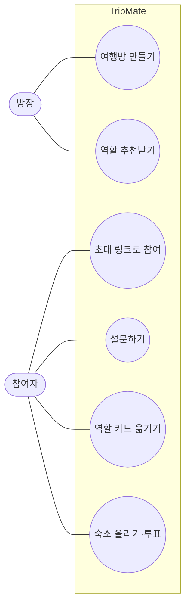

# TripMate

7~8명이 같이 가는 여행에서 누가 무엇을 맡을지 **설문으로 추천**하고, 숙소는 **모두가 싫어하지 않는 곳**으로 고르게 돕는 웹 서비스다.
부트캠프 2기 팀 프로젝트(박재현·문지훈·김현수).

| 기능 | 하는 일 |
|---|---|
| 설문 → 역할 추천 | 차 유무·계획 성향·맡기 싫은 일로 운전·총무·장보기를 정하고, 카드마다 근거("차 있음 +4")를 보여 준다 |
| 실시간 역할 보드 | 카드를 누르거나(휴대폰) 끌어 옮기면(PC) 같은 방 사람들 화면에도 바로 바뀐다. 둘이 동시에 옮기면 늦은 쪽은 409. 결과는 카톡용 글로 복사 |
| 숙소 투표 | 링크를 올리면 제목·사진을 가져온다. 조건별 평균과 **최솟값**을 같이 보여 "의견 갈림"을 드러낸다 |
| 로그인·초대 | 카카오 로그인, 초대 링크로 방에 들어온다 |

카톡 투표는 표만 센다. TripMate 는 왜 그 사람이 그 역할인지, 어떤 조건에서 의견이 갈렸는지를 보여 준다.

## 바로 실행

JDK 17 이상만 있으면 된다. DB 는 메모리 H2 라 설치할 것이 없다.

1. IntelliJ 로 저장소 폴더를 열고 Gradle 을 불러온다
2. 오른쪽 위 실행 메뉴 **`tripmate`** ▶ (개발용 로그인이 켜져 있다)
3. http://localhost:8080/login 에서 예시 방 참여자를 누른다. **재현**이 방장이다

```bash
DEV_LOGIN=true ./gradlew bootRun
```

서버를 다시 켜면 데이터는 처음으로 돌아간다. 실시간은 창을 두 개(하나는 시크릿 창) 띄워 다른 사람으로 들어가 보면 보인다.

## API

데이터는 모두 `/api/**` 에서 JSON 으로 주고받는다. 화면(Thymeleaf)의 jQuery `$.ajax` 가 부른다.
모든 방 API 는 로그인 안 했으면 **401**, 그 방 참여자가 아니면 **404**(방이 있는지도 알려 주지 않는다).

| 기능 | HTTP 메소드 | 경로(URI) | 응답 | 실패조건 | 담당 |
|---|---|---|---|---|---|
| 개발용 로그인 | POST | `/api/dev/login` | 204 + 세션 쿠키<br>요청 `{"name": "민지"}` | 이름이 비었거나 20자 넘으면 400 | 박재현 |
| 로그인 버튼 고르기 | GET | `/api/auth/options` | 200 `{"kakao": false, "dev": true}` | | 박재현 |
| 내 정보 | GET | `/api/me` | 200 `{"id": 2, "nickname": "민지"}` | 로그인 안 했으면 401 | 박재현 |
| 로그아웃 | POST | `/api/logout` | 204 | | 박재현 |
| 여행방 만들기 | POST | `/api/trips` | 201 방 JSON(만든 사람이 방장)<br>요청 `{"title": "겨울 펜션", "destination": "가평", "startDate": "2027-01-15", "endDate": "2027-01-17"}` | 여행 이름이 비면 400 | 박재현 |
| 여행방 보기 | GET | `/api/trips/{id}` | 200 `{"id": 1, "title": "...", "inviteCode": "...", "meId": 2, "members": [...]}` | | 박재현 |
| 초대 링크로 참여 | POST | `/api/invites/{inviteCode}` | 200 `{"tripId": 1}` (이미 있으면 그대로) | 코드가 틀리면 404 | 박재현 |
| 바뀜 알림 (SSE) | GET | `/api/trips/{id}/events` | `event: change` `data: roles` \| `members` \| `stays`, 15초마다 `ping` | | 박재현 |
| 설문 저장 | PUT | `/api/trips/{id}/members/{memberId}/survey` | 200 저장한 설문<br>요청 `{"activity": "INDOOR", "planning": "PLANNER", "hasCar": true, ..., "preferences": {"DETACHED": 5}}` | activity·planning 이 없거나 점수가 1~5 밖이면 400<br>남의 설문이면 403 | 문지훈 |
| 설문 보기 | GET | `/api/trips/{id}/members/{memberId}/survey` | 200 설문(본인·방장이 아니면 `mobilityLimited` 칸이 빠진다) | 설문 전이면 404 | 문지훈 |
| 역할 보드 | GET | `/api/trips/{id}/roles` | 200 `{"roles": [...], "assignments": [{"roleId": 4, "memberId": 2, "reasons": ["차 있음 +4"], "version": 0}]}` | | 문지훈 |
| 역할 추천 | POST | `/api/trips/{id}/roles/recommend` | 200 새 보드(손으로 옮긴 것도 다시 짠다) | 방장이 아니면 403 | 문지훈 |
| 역할 카드 옮기기 | PATCH | `/api/trips/{id}/roles/assignments/{memberId}` | 200 보드<br>요청 `{"roleId": 4, "version": 0}` (roleId null = 미배정) | 그 사이 누가 옮겼으면(version 다름) 409 | 문지훈 |
| 숙소 목록·그룹 취향 | GET | `/api/trips/{id}/stays` | 200 `{"amenities": [...], "preferences": {"DETACHED": {"avg": 4.5, "min": 3}}, "surveyed": 3, "stays": [...]}` | | 김현수 |
| 숙소 올리기 | POST | `/api/trips/{id}/stays` | 201 숙소<br>요청 `{"url": "https://...", "title": "숲속 독채", "amenities": ["DETACHED"]}` | url 이 `http(s)://` 가 아니면 400 | 김현수 |
| 숙소 투표 | PUT | `/api/trips/{id}/votes/{memberId}` | 204<br>요청 `{"stayId": 3}` (null = 취소) | 남의 표면 403, 숙소가 없으면 404 | 김현수 |

화면 주소(`/trips/1/roles` 같은 것)는 [화면 설계](docs/02-화면설계.md)에 있다. API 를 직접 불러 보려면 IntelliJ HTTP Client 나 Talend API Tester 에서 `POST /api/dev/login` 으로 세션부터 받는다.

## 구조

수업에서 배운 짜임 그대로다. 화면 컨트롤러는 템플릿만 돌려주고, 데이터는 jQuery 가 API 로 읽는다.

```
브라우저 ─GET /trips/1/roles──────▶ RolePageController ─▶ templates/role/roles.html
   │
   └ roles.js $.ajax ─GET /api/trips/1/roles─▶ RoleController ─▶ RoleService ─▶ RoleRepository ─▶ DB
                                                (권한: TripAccess)     (계산)        (JPA)
```

| 무엇 | 쓰는 것 |
|---|---|
| 서버 | Spring Boot 4 · Java 17 · Gradle |
| 화면 | Thymeleaf · HTML · CSS · jQuery |
| DB | Spring Data JPA · H2(로컬) / PostgreSQL(배포) |
| 로그인 | Spring Security + 카카오 OAuth2, 세션 쿠키 |
| 실시간 | SSE(`SseEmitter`) |

```
src/main/java/com/tripmate/
  user/    로그인            박재현
  trip/    여행방·초대·SSE   박재현
  survey/  설문              문지훈
  role/    역할 추천·보드    문지훈
  stay/    숙소·투표         김현수
src/main/resources/
  templates/   화면. 기능별 폴더 + fragments/common.html(공통 머리·탭)
  static/      js/(화면마다 하나 + common.js), css/style.css
docs/          설계 문서, 각자 발표 정리(parts/)
```

## 설계

요구사항 → 화면 밑그림 → ERD → URL → UML 순서로 정했다.

| 문서 | 들어 있는 것 |
|---|---|
| [1. 주제와 요구사항](docs/01-주제와-요구사항.md) | 주제를 고른 까닭, REQ-01~17, 담당 |
| [2. 화면 설계](docs/02-화면설계.md) | 화면 목록 SCR-01~08, **와이어프레임**, 화면 흐름 |
| [3. DB 설계](docs/03-DB설계.md) | ERD, 표마다 정한 것과 까닭, 정규화 확인 |
| [4. URL 설계](docs/04-URL설계.md) | API 표(코드 위치까지) |
| [5. 역할 분담과 일정](docs/05-역할분담.md) | 사람별 남은 일, 4주 일정, 발표 순서 |
| [6. UML](docs/06-UML.md) | **유스케이스, 클래스 다이어그램, 시퀀스 다이어그램** |
| [7. 비슷한 서비스와 공공데이터](docs/07-비슷한-서비스와-공공데이터.md) | 비슷한 앱 비교, 쓸 수 있는 공공 API, 휴대폰 화면 점검, 할 순서 |
| [역할 추천 알고리즘](docs/matching.md) | 점수 규칙, 헝가리안을 쓴 까닭 |
| [팀 코드 규칙](docs/코드-규칙.md) | 층 나누기, 주석, 주소 규칙 |

<details>
<summary>유스케이스 미리 보기</summary>



</details>

## 테스트

```bash
./gradlew test
```

API 와 화면 테스트 56개. PR 을 올리기 전에 통과해야 한다.

## 같이 작업하기

브랜치 → PR → 리뷰 1명 → 합치기. 자세한 순서는 [CONTRIBUTING.md](CONTRIBUTING.md). 각자 발표 정리는 [내 파트 틀](docs/parts/_틀.md)을 복사해 쓴다.

## 카카오 로그인 켜기 (키가 있는 사람만)

키가 없어도 개발용 로그인으로 모든 기능을 쓴다.

1. 저장소 맨 위 폴더에 `secrets.properties` 를 만든다. git 에 안 올라간다. 값은 팀장에게 따로 받는다

   ```properties
   KAKAO_CLIENT_ID=REST API 키
   KAKAO_CLIENT_SECRET=클라이언트 시크릿
   ```

2. 서버를 다시 켜면 로그인 화면에 카카오 버튼이 나온다

카카오 개발자 콘솔의 Redirect URI 는 `http://localhost:8080/login/oauth2/code/kakao` 다.
배포할 때는 `{배포 주소}/login/oauth2/code/kakao` 를 하나 더 넣고, `DEV_LOGIN` 은 켜지 않는다.
