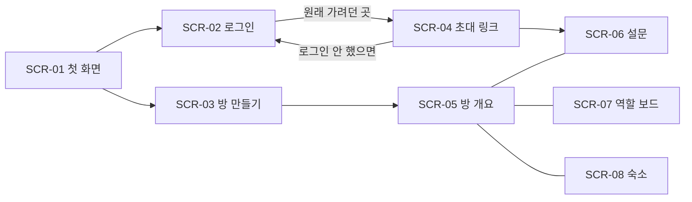

# 2. 화면 설계

화면은 Next.js(`frontend/src/app/`)에 있고, 데이터는 Spring API 로 읽고 쓴다.

## 화면 목록

| 번호 | 화면 | 주소 | 파일 | 보이는 칸 | 담당 |
|---|---|---|---|---|---|
| SCR-01 | 첫 화면 | `/` | `app/page.tsx` | 소개, 로그인, 여행방 만들기 | 박재현 |
| SCR-02 | 로그인 | `/login?next=...` | `app/login/` | 카카오 버튼, 개발용 로그인(로컬만) | 박재현 |
| SCR-03 | 여행방 만들기 | `/trips/new` | `app/trips/new/page.tsx` | 이름, 지역, 출발·도착일 | 박재현 |
| SCR-04 | 초대 링크로 들어오기 | `/join/{초대코드}` | `app/join/[code]/` | (로그인 안 했으면 SCR-02 로) | 박재현 |
| SCR-05 | 방 개요 | `/trips/{id}` | `app/trips/[tripId]/page.tsx` | 설문 진행, 참여자(사진·방장·설문 여부), 초대 링크 복사 | 박재현 |
| SCR-06 | 설문 | `/trips/{id}/survey` | `app/trips/[tripId]/survey/` | 질문 6개를 한 장씩, 숙소 조건 중요도 1~5 | 문지훈 |
| SCR-07 | 역할 보드 | `/trips/{id}/roles` | `app/trips/[tripId]/roles/` | 역할 칸(필수·정원), 사람 카드(근거), 추천받기(방장) | 문지훈 |
| SCR-08 | 숙소 | `/trips/{id}/stays` | `app/trips/[tripId]/stays/` | 그룹 취향 막대, 숙소 표(점수·투표·조건), 링크 올리기 | 김현수 |

방 화면(SCR-05~08) 위쪽의 방 이름·내 이름·로그아웃·탭은 `app/trips/[tripId]/layout.tsx` 하나로 같이 쓴다.

## 화면 흐름

## 확인

- [x] 모든 요구사항(REQ)이 어느 화면에 있다
- [x] 화면마다 담당이 있다
- [x] 방 화면 공통 머리는 `layout.tsx` 하나로
