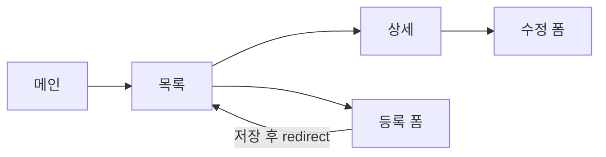

# 2. 화면 설계

DB 를 만들기 전에 화면부터 정한다. 화면에 보이는 칸이 곧 표의 칸이 된다.

## 화면 목록

| 번호 | 화면 | 주소 | 템플릿 | 보이는 칸 | 담당 |
|---|---|---|---|---|---|
| SCR-01 | 메인 | `GET /` | `index.html` | | |
| SCR-02 | 회원가입 | `GET /members/new` | `members/form.html` | 이름, 이메일, 비밀번호 | |
| SCR-03 | 로그인 | `GET /login` | `login.html` | 이메일, 비밀번호 | |
| SCR-04 | | | | | |

## 화면 흐름



주제가 정해지면 위 그림을 우리 화면으로 바꾼다.

## 그림(와이어프레임)

손으로 그리거나 Figma·PowerPoint 로 그린 사진을 `docs/images/` 에 넣고 여기 붙인다.

```

```

## 확인

- [ ] 모든 요구사항(REQ)이 어느 화면에 있다
- [ ] 화면마다 담당이 있다
- [ ] 공통 머리·메뉴는 `fragments/header.html` 하나로
