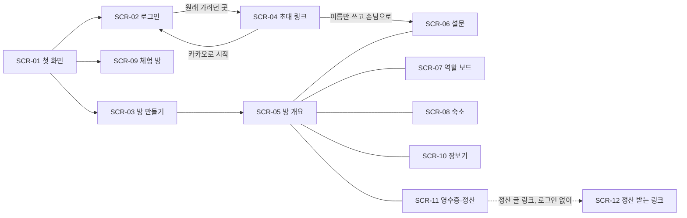

# 2. 화면 설계

수업 방식 그대로다. **화면 컨트롤러(`@Controller`)가 Thymeleaf 템플릿을 돌려주고, 템플릿 안의 jQuery 가 `$.ajax` 로 `/api/...` 를 불러 내용을 채운다.**
(수업 노션의 `UserPageController` → `info.html` → `$.ajax("/apis/users/...")` 와 같은 짜임)

- 템플릿: `src/main/resources/templates/<기능>/`
- 화면 JS: `src/main/resources/static/js/`, 모양: `static/css/style.css`
- 방 화면(SCR-05~08, SCR-10·11) 위쪽의 방 이름·내 이름·로그아웃·탭은 `templates/fragments/common.html` 의 `tripHeader` 조각 하나로 같이 쓴다(`th:replace`)
- 로그인·참여자 검사는 API 가 한다. 로그인이 풀려 있으면 API 가 401 을 주고, `common.js` 의 `api()` 가 `/login?next=지금주소` 로 보낸다. 초대 화면(SCR-04)만은 401 이면 로그인으로 보내지 않고 이름 칸을 연다

## 화면 목록

| 번호 | 화면 | 주소 | 화면 컨트롤러 | 템플릿 / JS | 보이는 칸 | 담당 |
|---|---|---|---|---|---|---|
| SCR-01 | 첫 화면 | `/` | `TripPageController.home` | `index.html` | 내 여행방(로그인 시), 소개·미리보기·실제 화면 아홉 장으로 보는 흐름(스크롤하면 바뀌는 휴대폰)·비교·자주 묻는 것, 여행방 만들기 ([화면 개편](08-화면-개편.md)) | 박재현 |
| SCR-09 | 체험 방 | `/demo` | `TripPageController.demo` | `trip/demo.html` / `demo.js` | 예시 여행의 개요·역할·숙소(읽기 전용, 로그인 없음), 내 여행방 만들기 | 박재현 |
| SCR-02 | 로그인 | `/login?next=...` | `LoginPageController.login` | `user/login.html` / `login.js` | 카카오 버튼 | 박재현 |
| SCR-03 | 여행방 만들기 | `/trips/new` | `TripPageController.newTrip` | `trip/new.html` / `trip-new.js` | 이름, 지역, 출발·도착일 | 박재현 |
| SCR-04 | 초대 링크로 들어오기 | `/join/{초대코드}` | `TripPageController.join` | `trip/join.html` / `join.js` | 로그인돼 있으면 바로 참여해 설문으로. 안 했으면 이름 칸("이름만 쓰고 바로", 손님)과 카카오로 시작 단추 | 박재현 |
| SCR-05 | 방 개요 | `/trips/{id}` | `TripPageController.overview` | `trip/overview.html` / `trip.js`, `dates.js` | 다음 할 일(내 상태별), 준비 체크, 날짜 맞추기(되는 날·몇 박 후보·방장이 정하기), 모일 시간·장소, 방 규칙, 회비(1인 얼마·누구에게·몇 명 냈어요, 냈어요 한 번, 총무는 받음 표시, 안 낸 사람 콕 찌르기), 참여자(방장 넘기기·빼기·방 나가기), 초대 링크 보내기, 방·침대 뽑기, 2탄 방 알림, 이름·지역 고치기와 방 지우기(방장), 손님에게 카카오로 잇기 띠 | 박재현 |
| SCR-06 | 설문 | `/trips/{id}/survey` | `SurveyPageController` | `survey/survey.html` / `survey.js` | 질문을 한 장씩(방 날짜가 없으면 첫 장에 되는 날 달력, 차가 있으면 출발 동네 장이 더 나온다), 숙소 조건 중요도 1~5 | 문지훈 |
| SCR-07 | 역할 보드 | `/trips/{id}/roles` | `RolePageController` | `role/roles.html` / `roles.js` | 역할 칸(필수·정원), 사람 카드(근거·나·설문 전), 역할 고르기 창, 결과 카드(그림, 배정이 있을 때), 글로 복사, 추천받기(방장), 이동·회비 근거 | 문지훈 |
| SCR-08 | 숙소 | `/trips/{id}/stays` | `StayPageController` | `stay/stays.html` / `stays.js` | 그룹 취향 막대, 숙소 카드(순위·점수·투표·조건·빠진 조건·1인 얼마), 링크나 공유 글 붙여 넣기(이름·사진·조건·가격 미리 채움) | 김현수 |
| SCR-10 | 장보기 | `/trips/{id}/shopping` | `ShoppingPageController` | `shopping/shopping.html` / `shopping.js` | 얼마나 사요(인원·술 마시는 사람·박 수, 1인 고기 g), 줄마다 내가 살게·쓴 돈, 쓴 돈 합계와 1인 몫, 카톡으로 목록 보내기 | 문지훈 |
| SCR-12 | 정산 받는 링크 | `/s/{code}` | `SettlePageController` | `settle/shared.html` / `settle-shared.js` | 로그인 없이: 방 이름·날짜·모두 얼마, 누가 누구에게 얼마, 끝난 송금, 먼저 낸 돈(접힘), "나는" 이름 고르면 내 줄만 진하게. 계좌·방 링크 없음, 검색 제외 | 문지훈 |
| SCR-11 | 영수증·정산 | `/trips/{id}/receipt` | `TripPageController.receipt` | `trip/receipt.html` / `receipt.js`, `settle.js` | 우리 여행 영수증 그림(역할·1인 숙소비·교통비·규칙), 누가 누구에게 얼마, 보냈어요·받았어요, 술 마신 사람, 먼저 낸 돈 적기(나눌 사람 고르기), 2탄 방 열기 | 문지훈 |
| (공통) | 카카오 로그인 뒤 | `/login/done` | `LoginPageController.loginDone` | `user/login-done.html` / `login-done.js` | 로그인 전에 보던 곳으로 돌아감 | 박재현 |

## 화면 흐름



## 와이어프레임

코드 전에 정한 화면 밑그림이다. 칸 이름이 곧 API 의 칸이 되었다(→ [URL 설계](04-URL설계.md)).

**SCR-02 로그인**

```
┌──────────────────────────────────┐
│ TripMate 로그인                   │
│ ┌──────────────────────────────┐ │
│ │      카카오로 시작하기         │ │  ← GET /oauth2/authorization/kakao
│ └──────────────────────────────┘ │
└──────────────────────────────────┘
```

**SCR-05 방 개요** (방 화면 위쪽 머리·탭은 같다. 탭은 개요·설문·역할·숙소·장보기 다섯, 영수증은 개요·역할 화면의 단추로 들어간다)

```
┌──────────────────────────────────────────────────────┐
│ TripMate                              (재) 재현 로그아웃 │
│ 겨울 펜션 2박 3일                                       │
│ 가평 · 2027-01-15 ~ 2027-01-17 · 8명                   │
│ [개요] 설문  역할  숙소  장보기                          │
├──────────────────────────────────────────────────────┤
│ 설문 진행                                        3/8   │
│ ███████░░░░░░░░░░░                                    │
├──────────────────────────────────────────────────────┤
│ 참여자                                  초대 링크 복사   │
│ ┌────────────┐┌────────────┐┌────────────┐┌─────────┐ │
│ │(재) 재현·방장││(민) 민지    ││(도) 도윤    ││ ...     │ │
│ │ 설문 완료   ││ 설문 전     ││ 설문 완료   ││         │ │
│ └────────────┘└────────────┘└────────────┘└─────────┘ │
└──────────────────────────────────────────────────────┘
```

**SCR-06 설문** (한 장에 한 질문, 마지막 장은 숙소 조건 점수)

```
┌──────────────────────────────┐   ┌──────────────────────────────────┐
│ ████░░░░░░░                   │   │ 숙소에서 이건 얼마나 중요해요?      │
│ 재현 · 3 / 7                  │   │ 1 = 없어도 됨, 5 = 꼭 있어야 함     │
│ 차를 가져갈 수 있나요?          │ → │ 독채        [1][2][3][4][5]       │
│ ┌──────────┐ ┌──────────┐     │   │ 개별 바베큐  [1][2][3][4][5]       │
│ │  가능     │ │  어려움   │     │   │ ...                              │
│ └──────────┘ └──────────┘     │   │ ← 이전                 [저장하기]  │
│ ← 이전                        │   └──────────────────────────────────┘
└──────────────────────────────┘          PUT /api/trips/1/members/1/survey
```

**SCR-07 역할 보드** (카드를 누르면 역할 고르기 창이 뜬다. PC 는 끌어 옮겨도 된다)

```
                              [카톡용 글 복사] [다시 추천받기] ← 방장만
┌ 총무·타임라인 필수 1/1 ┐┌ 운전 필수 2/2 ──┐┌ 장보기 필수 0/1 ┐┌ 미배정 ──┐
│ 회비 걷기 · 일정표 공유 ││ 차량 픽업 · 주유 ││ (빈 칸은 빨간 테)││          │
│ ┌──────────────────┐ ││ ┌─────────────┐ ││                 ││ ┌──────┐ │
│ │ 도윤              │ ││ │ 재현         │ ││                 ││ │ 시우 │ │
│ │ 계획형 +3         │ ││ │ 차 있음 +4   │ ││                 ││ └──────┘ │
│ └──────────────────┘ ││ └─────────────┘ ││                 ││          │
└──────────────────────┘└─────────────────┘└─────────────────┘└──────────┘
   카드 놓기·고르기 → PATCH /api/trips/1/roles/assignments/{사람}  (늦으면 409 안내)
```

카드를 누르면 뜨는 역할 고르기 창(휴대폰은 화면 아래에 붙는다)

```
┌──────────────────────────────┐
│ 서연 님을 어디로 옮길까요?      │
│ 총무·타임라인            1/1 · 가득 │  ← 가득 차도 고를 수 있다(사람 판단)
│ 운전                     0/2  │
│ ...                           │
│ 미배정               지금 여기 │  ← 지금 칸은 못 누른다
│           [닫기]               │
└──────────────────────────────┘
```

휴대폰 브라우저(특히 카톡 안 브라우저)는 HTML5 끌어 놓기가 잘 안 돼서 누르고 고르는 길을 같이 뒀다.
카톡용 글 복사는 역할별 이름, 설문 안 한 사람, 초대 링크를 한 덩이로 만들어 단톡방에 붙이게 한다.

보드 아래 이동·회비 근거(REQ-18, "계산하기"를 누를 때만 카카오를 부른다)

```
┌ 이동·회비 근거 ───────────────────── [계산하기] ┐
│ 재현 운전   편도 62km · 1시간 10분 · 기름 8,800원 · 통행료 3,200원 │
│ 민지 운전   편도 41km · 55분 · 기름 5,900원 · 통행료 0원          │
│ 도윤        설문에 출발 동네가 없어요                              │
│ 1인 교통비 약 4,500원 (운전하는 차 왕복, 8명)                       │
│ 길·통행료: 카카오모빌리티 · 휘발유 1,700원/L(어림값) · 연비 12km/L │
└──────────────────────────────────────────────┘
```

**SCR-08 숙소**

```
┌ 우리 그룹이 중요하게 보는 것 ─────────────────────────┐
│ 독채       ██████████████│░░░░░  4.5점                 │  막대 = 평균
│ 온수풀     ████████│░░░░░░░░░░░  의견 갈림            │  세로선 = 최솟값
└────────────────────────────────────────────────────┘
┌ 숙소 ───────┬──────┬──────┬─────┬────────┬─────┐
│ 숲속 독채    │ 9.0  │ [3표] │ ✓  │   ✓    │     │  ← PUT /api/trips/1/votes/1
│ 바다 펜션    │ 6.5  │ [1표] │     │   ✓    │ ✓   │
└─────────────┴──────┴──────┴─────┴────────┴─────┘
┌ 숙소 링크 올리기 ────────────────────────────────────┐
│ ┌──────────────────────────────────────────────┐    │
│ │ 링크나 공유 글 붙여 넣기                         │    │  ← 붙이자마자 POST /api/trips/1/stays/preview
│ └──────────────────────────────────────────────┘    │
│ 네이버 지도 · 카카오맵 · 에어비앤비 · 야놀자 · 여기어때 · 네이버 호텔 · 아고다 · 블로그 글 │
│ (사진) 링크에서 찾아 채웠어요: ...                      │
│ [이름]  1박 가격(원, 몰라도 돼요) [240000]              │
│ ☑독채 ☐온수풀 ...                           [올리기]   │  ← POST /api/trips/1/stays
└────────────────────────────────────────────────────┘
```

지도 앱의 "공유"로 복사한 글(`[네이버 지도]` 이름, 주소, 링크가 섞인 여러 줄)을 그대로 붙여도 된다. `ShareText` 가 첫 링크와 이름 줄을 꺼낸다. 한 줄 칸은 붙일 때 줄바꿈을 지워 이름과 주소가 붙어서 여러 줄 칸(textarea)으로 했다.

## 실시간

다른 사람이 바꾼 것은 새로고침 없이 보인다. 방 화면은 `common.js` 의 `listen()` 으로 `GET /api/trips/{id}/events`(SSE)를 열어 두고,
서버가 `change` 로 `roles | members | stays | dates | trip | shopping | settle | deleted` 를 보내면 그 화면이 API 를 다시 불러 그린다.
`deleted` 는 방장이 방을 지운 것이라 방 개요를 보던 사람은 첫 화면으로 간다.

## 확인

- [x] 모든 요구사항(REQ)이 어느 화면에 있다
- [x] 화면마다 담당이 있다
- [x] 방 화면 공통 머리는 `fragments/common.html` 하나로
- [x] 사용자가 넣은 값은 jQuery `.text()` 로만 넣는다(`.html()` 에 넣지 않는다, XSS)
