# 3. DB 설계 (JPA 엔티티 → H2 로컬 / Postgres 배포)

표는 SQL 로 직접 만들지 않고 JPA 엔티티(`src/main/java/com/tripmate/<기능>/`)에서 만들어진다(`ddl-auto`).
표 이름·칸 이름은 엔티티 이름을 snake_case 로 바꾼 것이다(`SurveyAnswer.hasCar` → `survey_answer.has_car`).

## ERD

엔티티는 기능별 패키지(user, trip, survey, role, stay)에 있다.
`xxx_*` 보조 테이블(@ElementCollection)은 본 테이블 칸으로 묶어 적었다.

```mermaid
erDiagram
    APP_USER ||--o{ MEMBER : "방마다 참여"
    TRIP ||--o{ MEMBER : "참여"
    TRIP ||--o{ ROLE : "역할 목록"
    TRIP ||--o{ STAY : "후보 숙소"
    MEMBER ||--o| SURVEY_ANSWER : "설문 1장"
    MEMBER ||--o| ASSIGNMENT : "역할 1개"
    ROLE ||--o{ ASSIGNMENT : "capacity 명까지"
    MEMBER ||--o| VOTE : "1표"
    STAY ||--o{ VOTE : "받은 표"
    MEMBER |o--o{ STAY : "올린 사람"

    TRIP {
        bigint id PK
        varchar invite_code UK "초대 링크용"
        varchar title
        varchar destination
        date start_date
        date end_date
    }
    APP_USER {
        bigint id PK
        varchar login_id UK "kakao:123 / dev:민지"
        varchar nickname
        varchar profile_image_url "카카오 사진, 선택 동의"
    }
    MEMBER {
        bigint id PK
        bigint trip_id FK
        bigint user_id FK
        varchar name
        boolean host
        boolean survey_done
    }
    SURVEY_ANSWER {
        bigint id PK
        bigint member_id FK,UK
        enum activity "INDOOR BOTH OUTDOOR"
        enum planning "PLANNER OUTLINE SPONTANEOUS"
        boolean has_car
        boolean separate_departure
        string departure "차로 갈 때 출발 동네, 본인·방장만"
        boolean mobility_limited "본인과 방장만"
        set avoid "survey_avoid"
        map preferences "survey_preference 1~5"
    }
    ROLE {
        bigint id PK
        bigint trip_id FK
        varchar title
        boolean required
        int capacity
        enum kind "TREASURER DRIVER GROCERY BBQ DJ RECORDER"
        list tasks "role_task"
    }
    ASSIGNMENT {
        bigint id PK
        bigint member_id FK,UK
        bigint role_id FK
        list reasons "assignment_reason"
        bigint version "낙관적 락"
    }
    STAY {
        bigint id PK
        bigint trip_id FK
        bigint added_by_id FK
        varchar title
        varchar url
        varchar image_url "OG 태그"
        set amenities "stay_amenity"
    }
    VOTE {
        bigint id PK
        bigint member_id FK,UK
        bigint stay_id FK
    }
```

## 정한 것과 까닭

| 정한 것 | 까닭 |
|---|---|
| Member 는 "그 방의 참여자"다. 계정은 `app_user`(카카오 로그인)이고 Member 가 `user_id` 로 가리킨다 | 방마다 다른 이름을 쓸 수 있고, 예시 방처럼 계정 없는 참여자도 둘 수 있다. `(trip_id, user_id)` 유일로 한 방에 한 번만 들어간다(`user` 는 Postgres 예약어) |
| 1인 1역할, 1인 1표, 1인 설문 1장을 `member_id` 유일 제약으로 막는다 | Member 가 방 하나에만 속하니 `(trip_id, member_id)` 가 따로 필요 없다 |
| 숙소 조건은 테이블 대신 enum `Amenity` | 목록이 정해져 있고, 설문 선호 축과 같아야 숙소 점수를 셀 수 있다 |
| 여러 명이 필요한 역할은 `capacity` | 배정 알고리즘(헝가리안)에서 역할을 capacity 칸만큼 늘려 사람 수와 맞춘다 |
| 역할마다 `kind`(RoleKind)를 둔다. 방을 만들면 kind 목록대로 기본 역할 6개가 생긴다 | 점수 규칙을 제목 문자열이 아니라 kind 로 고른다. kind 가 `Chore` 를 갖고 있어 "맡기 싫은 일"이면 감점한다 |
| 카드 이동은 Assignment 의 role 만 바꾸고 `@Version` 으로 막는다 | 동시에 옮기면 늦은 쪽이 409 를 받고 화면을 최신으로 되돌린다 |
| `mobility_limited` 는 응답 DTO 를 둘로 나눠 숨긴다 | 본인·방장용 DTO 에만 넣고, 모두용에는 넣지 않는다 |
| 방 id 와 별도로 `invite_code` | id 를 링크에 쓰면 숫자만 바꿔 남의 방에 들어올 수 있다 |

## 아직 없는 것

- 숙소 조건 고치기·숙소 지우기(REQ-16), 방 수정·삭제와 나가기(REQ-05·06), 역할 더하기·고치기·지우기(REQ-12)

## 정규화 확인

- [x] 1정규형: 한 칸에 값 하나만. 여러 값(맡기 싫은 일, 숙소 조건, 역할 할 일)은 보조 표(`survey_avoid`, `stay_amenity`, `role_task`)로 뺐다
- [x] 2정규형: 보조 표는 (주인 id, 값)이 키이고 다른 칸이 없다
- [x] 3정규형: 참여자 표에 계정 닉네임·사진을 복사해 두지 않고 `user_id` 로 가리킨다
- [x] N:M: 사람-숙소 투표는 `vote` 표로 푼다

## 더한 표와 칸(2026-11-20~21)

| 표·칸 | 무엇 | 왜 |
|---|---|---|
| `trip.driver_pays_fuel`, `refund_no_show`, `drinks_separate` | 방 규칙 세 개(null = 아직 안 정함) | 기름값·불참 예약금·술값 싸움을 출발 전에. 정산이 그대로 읽는다 |
| `trip.previous_trip_id` (unique) | 같은 멤버로 이어 만든 2탄 방이 가리키는 지난 방 | 두 사람이 같이 눌러도 2탄 방은 하나 |
| `member.departed` | 방을 나감(행은 지우지 않는다) | 먼저 낸 돈·보낸 돈은 정산에 남고, "예약금 안 돌려줘요"면 숙소 몫도 진다. 다른 화면·셈에서는 빠진다(`Trip.getMembers()`) |
| `member.drinks` | 술 마시나(null = 마심) | 장보기 술 양, 규칙 "술값은 마신 사람만" 정산 |
| `trip.meet_time`, `meet_place` | 모일 시간·장소 | 하루 전부터 방 머리에 뜬다 |
| `member_available_date` | 사람마다 되는 날 | 날짜 맞추기 |
| `assignment.by_hand` | 손으로 놓거나 옮긴 역할 카드 | 늦게 온 사람 때문에 다시 짤 때 그 뜻은 지우지 않는다 |
| `shopping_plan`, `shopping_claim` | 장보기 기준(술 마시는 사람 수·1인 고기 g), "내가 살게"와 쓴 돈 | 장보기 |
| `expense`, `expense_sharer` | 먼저 낸 돈(숙소·주유·식비·술·기타)과 나눌 사람(비면 기본) | 정산 |
| `payment` | 보냈어요·받았어요(보낸·받은·누른 사람, 금액) | 남은 보낼 줄에서 빠진다 |

새 칸은 모두 null 을 받는다(Boolean). 데이터가 있는 DB 에 `DDL_AUTO=update` 로 NOT NULL 칸을 더하면 실패해서다.

## 이름 규칙

- 엔티티는 단수 CamelCase(`SurveyAnswer`), 표는 snake_case(`survey_answer`). `user` 는 Postgres 예약어라 `app_user`
- 외래 키는 `<엔티티>_id`: `trip_id`, `member_id`
- 비밀값(카카오 키)은 `secrets.properties` 에만. 저장소에 올리지 않는다
