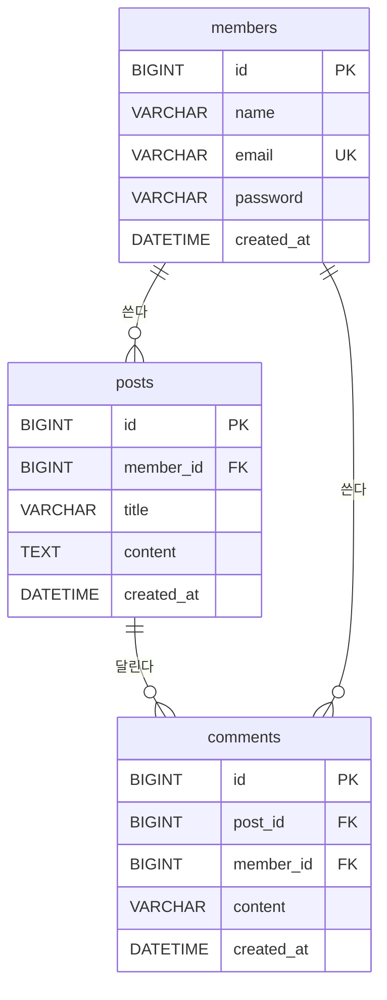

# 3. DB 설계 (MySQL 8)

DB 수업에서 배운 순서대로 한다.

1. **개념 설계**: 화면 목록에서 명사를 뽑아 엔티티로(회원, 글, 댓글…)
2. **논리 설계**: 칸과 관계(1:1, 1:N, N:M)를 정하고 ERD 를 그린다
3. **정규화**: 아래 확인표
4. **물리 설계**: `src/main/resources/schema.sql` 로 옮긴다

## ERD

주제가 정해지면 아래 예시를 우리 표로 바꾼다(GitHub 에서 그림으로 보인다).

## 표 정의

| 표 | 칸 | 타입 | 키/제약 | 설명 |
|---|---|---|---|---|
| members | id | BIGINT | PK, AUTO_INCREMENT | |
| | email | VARCHAR(100) | UNIQUE, NOT NULL | 로그인 아이디 |
| | | | | |

## 정규화 확인

- [ ] 1정규형: 한 칸에 값 하나만 (`"자바,스프링"` 처럼 쉼표로 넣지 않는다)
- [ ] 2정규형: 키 전체에 기대는 칸만 그 표에 둔다
- [ ] 3정규형: 키가 아닌 칸에 기대는 칸은 따로 뺀다 (글 표에 작성자 이름을 같이 두지 않는다)
- [ ] N:M 은 가운데 표로 푼다 (예: 회원-스터디 → applications)

## 이름 규칙

- 표는 복수 snake_case: `members`, `study_comments`
- 외래 키는 `<표 단수>_id`: `member_id`
- 모든 표에 `id`, `created_at`
- 접속 정보(비밀번호)는 `application-local.yml` 에만. 저장소에 올리지 않는다
