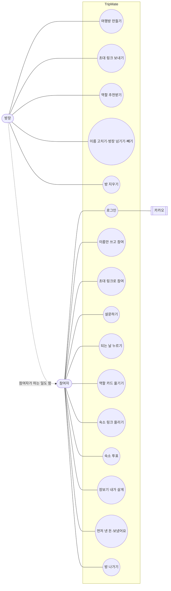
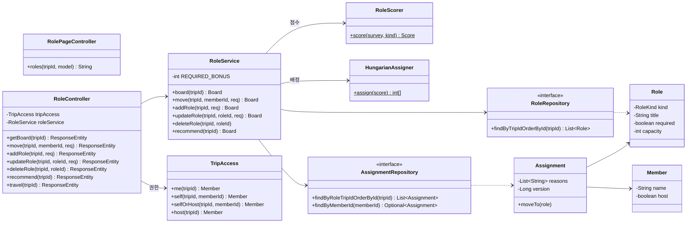
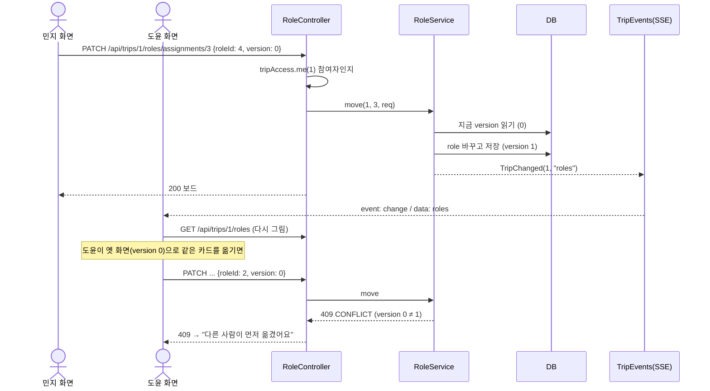
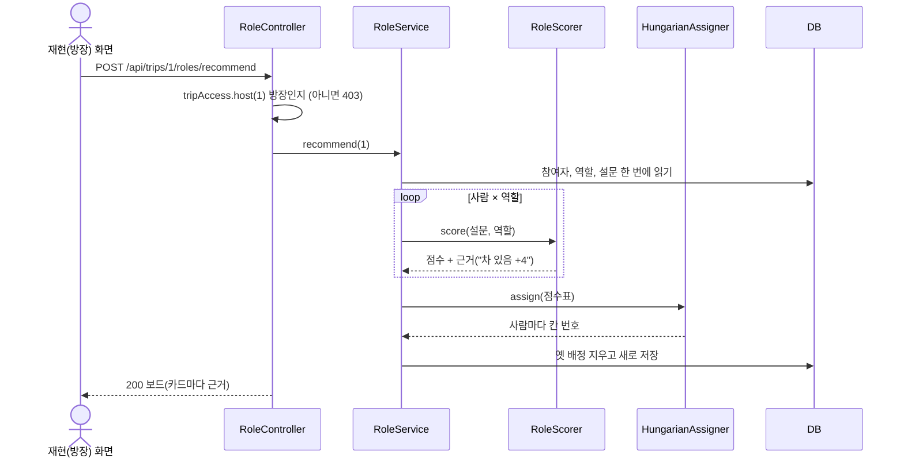

# 6. UML

소프트웨어공학 수업 순서대로 유스케이스 → 클래스 → 시퀀스를 그렸다. 표(ERD)는 [3. DB 설계](03-DB설계.md)에 있다.
GitHub 에서 열면 그림으로 보인다(mermaid). 수정은 이 파일 글자를 고치면 된다.

## 1. 유스케이스

누가 무엇을 하는지. 방장은 참여자가 하는 일을 다 하고, 둘레 친 일을 더 한다.

| 유스케이스 | 할 수 있는 사람 | 요구사항 |
|---|---|---|
| 로그인 | 누구나 | REQ-01 |
| 여행방 만들기, 초대 링크 보내기 | 로그인한 사람(만들면 방장) | REQ-02, REQ-03 |
| 초대 링크로 참여 | 로그인한 사람, 또는 로그인 없이 이름만 쓴 손님 | REQ-03 |
| 설문하기 | 참여자 본인 | REQ-07, REQ-08 |
| 역할 추천받기 | 방장 | REQ-09 |
| 역할 카드 옮기기 | 참여자 | REQ-10, REQ-11 |
| 숙소 링크 올리기, 투표 | 참여자 | REQ-13~15 |
| 되는 날 누르기, 장보기 내가 살게, 먼저 낸 돈 적기·보냈어요 | 참여자 | (번호 없음, [1. 요구사항](01-주제와-요구사항.md)) |
| 방 나가기 | 참여자 본인 | REQ-06 |
| 이름·지역 고치기, 방장 넘기기, 참여자 빼기, 방 지우기 | 방장 | REQ-05, REQ-06 |

## 2. 클래스 다이어그램

기능마다 같은 모양이다. 화면 컨트롤러는 템플릿만 돌려주고, API 컨트롤러가 권한을 본 뒤 Service 에 맡긴다.
아래는 역할 기능(문지훈). 다른 기능도 `XxxPageController`, `XxxController`, `XxxService`, `XxxRepository` 이름으로 같다.

기능 폴더는 층마다 같은 이름이다(예: `controller/role`, `service/role`, `entity/role`).

| 기능 폴더 | 화면 컨트롤러 | API 컨트롤러 | 서비스 | 엔티티 |
|---|---|---|---|---|
| `user` | `LoginPageController` | `AuthController` | `KakaoUserService`, `GuestService` | `AppUser`, `PersistentLogin` |
| `trip` | `TripPageController` | `TripController` | `TripService` | `Trip`, `Member` |
| `survey` | `SurveyPageController` | `SurveyController` | `SurveyService` | `SurveyAnswer` |
| `role` | `RolePageController` | `RoleController` | `RoleService` | `Role`, `Assignment` |
| `stay` | `StayPageController` | `StayController` | (김현수 1주 차) | `Stay`, `Vote` |
| `shopping` | `ShoppingPageController` | `ShoppingController` | `ShoppingService` | `ShoppingPlan`, `ShoppingClaim` |
| `settle` | (영수증·정산 화면은 `TripPageController.receipt`) | `SettleController` | `SettleService` | `Expense`, `Payment` |

## 3. 시퀀스 다이어그램

### 역할 카드 옮기기 (동시에 옮기면 409, 다른 화면은 SSE 로 갱신)

### 역할 추천 (방장)

점수 규칙과 헝가리안을 쓴 까닭은 [역할 추천 알고리즘](matching.md)에 있다.
