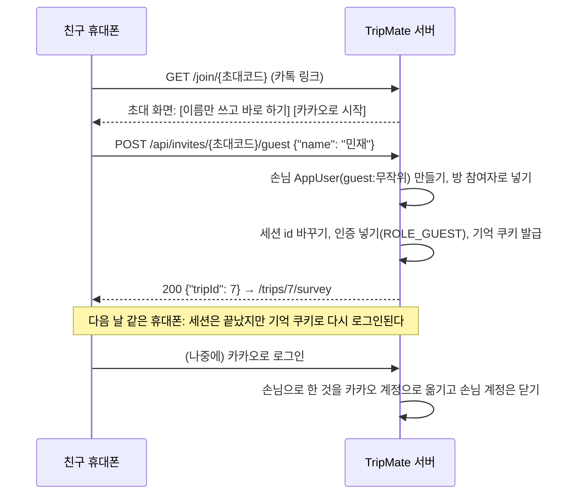

# 19. 로그인 없이 참여(손님) 설계

2026-11-21. docs/18 의 채택 시뮬레이션에서 8명 방의 가장 큰 이탈은 **카카오 로그인 동의**였다. 링크를 누른 5~6명 가운데 4~5명만 남는다고 추정했다. 이 문서는 친구들이 **이름만 쓰고 바로** 설문·날짜·투표를 하게 하는 설계다. 코드는 아직 없다.

담당: 로그인·초대·보안은 **박재현**(docs/05). 이 설계는 그 몫을 건드리므로 박재현과 맞춘 뒤 만든다. 방 안 기능 쪽 손질은 문지훈이 맡는다.

## 1. 목표와 지키는 것

- 초대 링크를 누른 친구는 **이름 한 칸 + 단추 하나**로 방에 들어간다. 카카오 동의 화면이 없다
- 같은 휴대폰으로 다음 날 다시 와도 **나로** 들어온다(다시 이름을 안 쓴다)
- 나중에 카카오로 로그인하면 손님으로 한 것(설문·표·장보기·정산)이 **내 계정으로 옮겨진다**
- 방 만들기, 방장, 2탄 방 만들기는 지금처럼 **카카오 계정만** 한다(방의 주인이 있어야 한다)
- 지금 권한 검사(`TripAccess`: 방 사람이 아니면 404, 본인·방장 확인)는 **한 줄도 바꾸지 않는다**

## 2. 고른 방식: 손님 계정

| 방식 | 장점 | 단점 | 판정 |
|---|---|---|---|
| A. 손님도 `AppUser`(loginId `guest:무작위`)로 만들고 세션에 로그인시킨다 | `CurrentUser`·`TripAccess`·`Member` 가 그대로 돈다. 바뀌는 곳이 로그인 쪽에 모인다 | 손님을 오래 기억하려면 쿠키가 하나 더 필요하다 | **고름** |
| B. 계정 없이 방 참여자(`Member.user = null`)로만 두고 요청마다 참여자 토큰으로 확인 | 표가 하나 줄어든다 | 모든 API 가 "로그인 사용자"를 가정해서 권한 검사를 다 고쳐야 한다. 실수 한 번이 남의 방 열람이 된다 | 버림 |
| C. 방장이 사람마다 개인 링크를 보낸다 | 이름 고르기가 없다 | 방장 손이 사람 수만큼 늘어난다(편의성 원칙에 어긋남) | 버림 |

## 3. 흐름

## 4. 만드는 것

**데이터**

| 칸 | 무엇 |
|---|---|
| `app_user.guest` (Boolean, null = 아님) | 손님 계정 표시. 기존 행이 있는 DB 에 NOT NULL 칸을 더하지 않게 Boolean |
| `persistent_logins` | Spring Security 의 기억하기 표(`JdbcTokenRepositoryImpl` 기본 꼴). 토큰은 시리즈·토큰을 매번 바꿔 도둑맞은 쿠키를 알아챈다 |

**API**

| 기능 | 메소드 | 경로 | 응답 | 실패 |
|---|---|---|---|---|
| 손님으로 참여 | POST | `/api/invites/{inviteCode}/guest` `{"name": "민재"}` | 200 `{"tripId": 7}`, 세션 로그인 + 기억 쿠키 | 이름 비거나 20자 넘음 400, 코드 틀림 404, 한 방 손님 30명 넘음·한 IP 한 시간 10번 넘음 429 |
| 카카오로 옮기기 | (카카오 로그인 성공 처리 안) | — | 손님이던 세션이면 그 참여자들을 카카오 계정으로 | 같은 방에 카카오 계정이 이미 있으면 그 방은 옮기지 않고 손님 참여자를 나감 처리 |

**손님이 할 수 있는 것**

| 기능 | 손님 | 까닭 |
|---|---|---|
| 날짜 맞추기, 설문, 숙소 투표, 장보기 "내가 살게", 술 표시, 정산 적기·보냈어요, 방 뽑기, 나가기 | 된다 | 여기서 빠지는 사람을 막는 게 목적 |
| 방 만들기, 2탄 방 만들기 | 안 됨(403, "카카오로 시작하면 방을 만들 수 있어요") | 방에는 다시 찾아올 주인이 있어야 한다 |
| 방장 되기(넘겨받기, 방장이 나갈 때 이어받기) | 안 됨 | 같은 까닭. 방장이 나가면 카카오 계정인 사람 중 먼저 들어온 사람 |

**보안**

- **세션 고정 막기**: 손님 인증을 넣기 전에 `request.changeSessionId()`
- **로그인 CSRF**: 손님 참여는 JSON 만 받는다(@RequestBody). 다른 사이트의 form POST 는 415, 스크립트는 CORS 사전 요청에서 막힌다. 지금 CSRF 정책(docs/09)과 같은 논리
- **기억 쿠키**: HttpOnly, SameSite=Lax, 배포에서 Secure, 60일. 서버에는 토큰 해시만(Spring 기억하기 기본). 로그아웃하면 지운다
- **남 흉내**: 손님은 늘 새 참여자로 들어온다. 이미 있는 이름을 골라 그 사람이 될 수는 없다. 같은 이름이면 "민재(2)"처럼 붙여 구분한다
- **가짜 참여자 도배**: 지금도 링크를 아는 사람은 누구나 들어온다(카카오 계정만 있으면). 손님은 더 쉬우니 한 방 손님 30명, 한 IP 한 시간 10번으로 묶고 방장은 "빼기"로 지운다
- **개인정보**: 손님은 이름(별명) 하나만 받는다. 카카오 정보도 전화번호도 없다

**화면**

- 초대 화면: 큰 단추가 "이름만 쓰고 바로 하기"(이름 칸이 함께 열림), 작은 글이 "카카오로 시작하면 다음 여행도 이어져요"
- 방 안: 손님에게 한 번만 "카카오로 이어 두면 다른 기기에서도 나로 들어와요" 띠. 닫으면 안 뜬다
- 첫 화면 "내 여행방"은 손님도 같은 휴대폰이면 보인다(기억 쿠키)

## 5. 시험 계획

| 시험 | 확인할 것 |
|---|---|
| 손님 참여 → 설문 → 역할 추천 | 손님도 역할을 받는다 |
| 손님이 남의 방 API | 404(지금 TripAccess 그대로) |
| 손님이 방 만들기·2탄·방장 넘겨받기 | 403 |
| 세션 끝난 뒤 기억 쿠키로 다시 | 같은 참여자 |
| 손님 → 카카오 로그인 | 설문·표·정산이 카카오 계정 참여자로 옮겨짐, 손님 계정 닫힘 |
| 이름 빈 칸·21자 / 30명째 손님 / 같은 IP 11번째 | 400 / 429 / 429 |
| form POST 로 손님 참여 | 415 |

## 6. 만드는 순서와 손 나누기

1. (박재현) `SecurityConfig` 에 기억하기와 `ROLE_GUEST`, 손님 참여 API, 세션 id 바꾸기, 횟수 제한
2. (박재현) 카카오 로그인 성공 때 손님 → 카카오 옮기기
3. (문지훈) 방 만들기·2탄·방장 넘기기에 손님 막기, 방장 이어받기 규칙, 초대 화면과 방 안 띠
4. 시험(5절)과 README·docs/04 API 표

## 7. 알고 남기는 한계

- 손님이 휴대폰을 바꾸거나 쿠키를 지우면 그 손님으로는 못 돌아온다. 그래서 방 안 띠로 카카오 연결을 권한다. 그래도 남은 손님 참여자는 방장이 빼면 된다
- 손님 숫자 제한은 서버 메모리에 둔다(서버 한 대 기준). 여러 대로 늘리면 Redis 같은 곳으로 옮긴다
