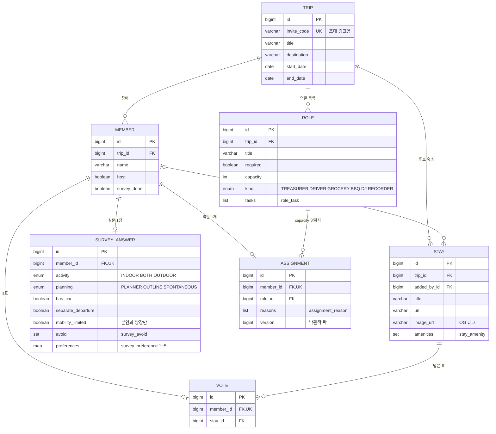

# ERD

엔티티는 `backend/src/main/java/com/tripmate/` 아래 기능별 패키지(trip, survey, role, stay)에 있다.
`xxx_*` 보조 테이블(@ElementCollection)은 본 테이블 칸으로 묶어 적었다.

## 정한 것과 까닭

| 정한 것 | 까닭 |
|---|---|
| Member 는 "그 방의 참여자"다. 계정이 아니다 | 로그인 전에도 방이 돌아간다. 카카오 로그인 때 `app_user` 를 만들고 Member 에 `user_id` 를 단다(`user` 는 Postgres 예약어) |
| 1인 1역할, 1인 1표, 1인 설문 1장을 `member_id` 유일 제약으로 막는다 | Member 가 방 하나에만 속하니 `(trip_id, member_id)` 가 따로 필요 없다 |
| 숙소 조건은 테이블 대신 enum `Amenity` | 목록이 정해져 있고, 설문 선호 축과 같아야 숙소 점수를 셀 수 있다 |
| 여러 명이 필요한 역할은 `capacity` | 배정 알고리즘(헝가리안)에서 역할을 capacity 칸만큼 늘려 사람 수와 맞춘다 |
| 역할마다 `kind`(RoleKind)를 둔다. 방을 만들면 kind 목록대로 기본 역할 6개가 생긴다 | 점수 규칙을 제목 문자열이 아니라 kind 로 고른다. kind 가 `Chore` 를 갖고 있어 "맡기 싫은 일"이면 감점한다 |
| 카드 이동은 Assignment 의 role 만 바꾸고 `@Version` 으로 막는다 | 동시에 옮기면 늦은 쪽이 409 를 받고 화면을 최신으로 되돌린다 |
| `mobility_limited` 는 응답 DTO 를 둘로 나눠 숨긴다 | 본인·방장용 DTO 에만 넣고, 모두용에는 넣지 않는다 |
| 방 id 와 별도로 `invite_code` | id 를 링크에 쓰면 숫자만 바꿔 남의 방에 들어올 수 있다 |

## 아직 없는 것

- `app_user` (카카오 로그인 때)
- 숙소 조건 고치기·숙소 지우기(올릴 때만 체크한다)
