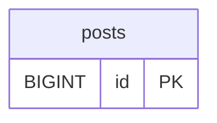

# 내 파트: (기능 이름) — (이름, GitHub 아이디)

이 파일을 복사해 `docs/parts/<GitHub아이디>.md` 로 만들고 채운다.
발표 전에 이것만 읽어도 내 파트를 설명할 수 있게 쓴다.

## 1. 한 줄 소개

(예: 사용자가 스터디 모집글을 쓰고, 보고, 고치고, 지울 수 있는 기능입니다.)

## 2. 맡은 것

| 무엇 | 내 것 |
|---|---|
| 요구사항 | REQ- |
| 화면 | SCR- |
| 표 | |
| 컨트롤러 | `controller/____Controller.java` |
| 서비스 | `service/____Service.java` |
| 레포지토리 | `repository/____Repository.java` |
| 템플릿 | `templates/____/` |

## 3. 요청 하나 따라가기 (발표의 핵심)

내 기능에서 요청 하나를 골라 순서대로 적는다. 예: 글 등록.

| 순서 | 어디서 | 무슨 일 | 코드 위치 |
|---|---|---|---|
| 1 | 브라우저 | 폼에 입력하고 등록 누름 → `POST /posts` | `posts/form.html` |
| 2 | Controller | 폼 값을 `PostForm` 으로 받음, `@Valid` 로 검사 | `PostController.create()` |
| 3 | Service | 규칙 확인(로그인했는지 등) 후 저장 요청 | `PostService.save()` |
| 4 | Repository | `INSERT INTO posts ...` | `PostRepository.save()` |
| 5 | DB | posts 표에 한 줄 추가 | |
| 6 | Controller | `redirect:/posts` → 목록으로 | |

왜 이렇게 나눴는지 한 줄: (예: SQL 을 Controller 에 두면 화면과 DB 를 같이 고쳐야 해서 나눴다.)

## 4. 내 표

이 칸들을 둔 이유, 다른 표와의 관계(1:N 등):

## 5. 시연 순서

1.
2.
3.

미리 넣어 둘 시연 데이터:

## 6. 어려웠던 점과 해결

| 문제 | 원인 | 해결 |
|---|---|---|
| | | |

## 7. 예상 질문

| 질문 | 답 |
|---|---|
| 왜 이 주소(URL)로 정했나요? | |
| 검증은 어디서 하나요? | |
| 표를 왜 이렇게 나눴나요? | |
| 같은 기능을 다시 만든다면? | |
